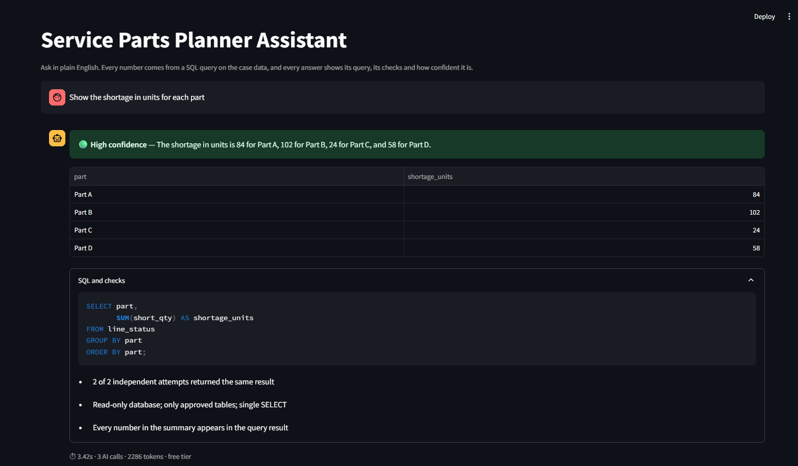

# Service Parts Planner Assistant

A small AI assistant for service-parts planners. A planner asks a question in plain English ("Which part has the biggest shortage?"), and the assistant answers from SQL on the case-study data.

The goal is **trust**: for a planner, a wrong number that looks right is worse than no answer. So the assistant shows its work, asks when a question is unclear, and says "I don't know" instead of guessing.



## What it does

| Planner concern | How the assistant handles it |
|---|---|
| **Accuracy** | The AI only writes the SQL. Every number comes from the database, never from the AI. The prompt holds approved business definitions (demand, shortage, fill rate) and verified example queries. |
| **Trust** | Each answer shows the SQL, the checks it passed and a confidence level: 🟢 high, 🟡 check this, 🔴 not sure / not in the data, 💬 needs one detail. |
| **Unclear questions** | If a question has two readings that give different numbers (starting stock vs. stock left after filling orders), it asks instead of picking one. |
| **Out of scope** | If the data can't answer it (supplier lead times, forecasts), it says so. |
| **Speed** | Two attempts run in parallel. A repeated question comes from a cache with 0 AI calls. |
| **Cost** | A smaller model writes the summary. A third attempt runs only when the first two disagree. Tokens and estimated cost are shown for every answer. |
| **Safety** | Read-only database, single SELECT only, approved tables only, 3-second query timeout. |

## How an answer is made

1. **Write SQL twice.** The question goes to the SQL model two times in parallel, with the schema, definitions and examples.
2. **Run and repair.** Each SQL runs on a read-only copy of the data. If it fails, the error goes back to the model once for a fix.
3. **Compare.** If both attempts return the same result → high confidence. If they disagree → a third attempt, and 2 of 3 must agree (🟡). No agreement → "I don't know."
4. **Clarify or decline.** If most attempts ask for clarification or say the data can't answer, the assistant does that instead.
5. **Summarize and check.** A smaller model writes a 1–3 sentence answer. Every number in it must appear in the query result. If not, the summary is dropped and only the table is shown.

The confidence level comes from agreement checks, not from a trained calibration model.

## Data

`build_db.py` loads the case Excel into SQLite and runs the allocation rule from my case analysis:
**oldest order first; own warehouse part → own warehouse substitute → parent warehouse part → parent warehouse substitute.**

| Table | What it holds |
|---|---|
| `order_lines` | 175 order lines (509 units) after removing duplicate rows |
| `line_substitutes` | Allowed substitute parts per line |
| `inventory` / `remaining_inventory` | Stock before and after allocation |
| `fills` | Which warehouse and part filled each line |
| `line_status`, `shortage_by_part_warehouse` | Approved views for filled, short and complete |

## Results

Test set: 18 planner questions in `eval_questions.json` (14 with a known correct SQL answer, 2 that should be clarified, 2 the data cannot answer). Run with `python eval.py`.

| Measure | Result |
|---|---|
| Correct answers (SQL questions) | _fill in_ |
| Wrong but marked high confidence | _fill in_ |
| Asked to clarify when it should | _fill in_ |
| Said "I don't know" when it should | _fill in_ |
| Average time per question | _fill in_ |
| Tokens for all 18 questions | _fill in_ (free tier) |
| Repeated question (cache) | 0 AI calls, under 0.1 s |

Known ambiguous terms (like "stock" and "late") are checked by a rule list in code before any AI call, so those questions are instant and free. The test set is small (18 questions on one dataset). It shows the method works. A real rollout would test on questions planners actually ask.

## Run it

```bash
pip install -r requirements.txt
cp .env.example .env          # Windows: copy .env.example .env   then paste your API key into .env
python build_db.py path/to/Case_Study_Excel.xlsx
streamlit run app.py
python eval.py                # optional: runs the test set, writes eval_results.txt
```

Uses the free Groq API (`openai/gpt-oss-120b` for SQL, `openai/gpt-oss-20b` for summaries). Any OpenAI-compatible API works by changing `.env`.

## Next steps

- Replace agreement-based confidence with a calibrated score trained on logged planner questions.
- Add a feedback button so wrong answers become new verified examples after review.
- Connect to live tables, and show data freshness with each answer.
